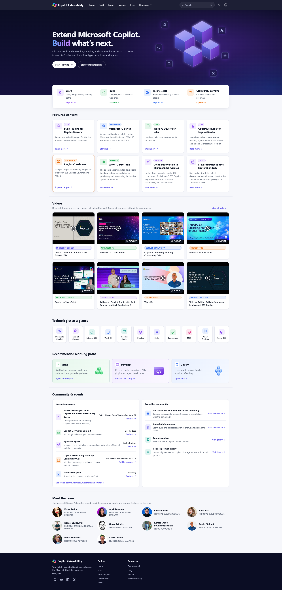

# Copilot Extensibility

This repository hosts the source code and curated content for the
[Copilot Extensibility website](https://microsoft.github.io/copilot-extensibility/), a unified starting point for
makers, developers, and architects who want to extend Microsoft Copilot and build AI-powered solutions.

The website brings together Microsoft 365 Copilot extensibility documentation, learning paths, featured content,
videos, technologies, community resources, events, and team information. Its purpose is to make the broader Copilot
extensibility ecosystem easier to discover and navigate without duplicating the source material.

The site is a static [Astro](https://astro.build/) application under [`site/`](site). Most website content is maintained
in JSON files under [`site/src/data/`](site/src/data), allowing contributors to update curated resources without
changing component markup. Changes merged into `main` are published automatically to GitHub Pages.

## License

Licensed under the [MIT License](LICENSE).
