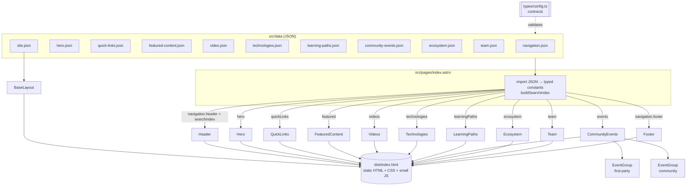

# Architecture of the Copilot Extensibility Landing Site

This document describes how the site is built, how its parts fit together, and the purpose and inner
workings of every component. To run the site locally see [DEVELOPING.md](./DEVELOPING.md); for publishing
instructions see [PUBLISHING.md](./PUBLISHING.md).

---

## 1. Goals and design principles

| Principle | How it is applied |
| --- | --- |
| **Aggregate, don't author** | The site links to existing resources (docs, repos, blogs, videos, labs, events…). It contains no long-form content of its own. |
| **Configuration over code** | Every block of the landing page is a component fed by its **own JSON file**. Content editors change JSON, not markup. |
| **Reusable components** | Components receive their configuration through a `config` prop instead of importing it, so the same component can be reused with a different JSON file (e.g. on a future sub-page). |
| **Static and fast** | Astro pre-renders everything to plain HTML/CSS at build time. The only client-side JavaScript is the small header script (menu, search, theme). |
| **Type-safe content** | Every JSON file has a TypeScript contract. `npm run check` fails if a JSON file is malformed or misses a required property. |
| **Accessible** | Semantic landmarks, labelled sections, keyboard-navigable menus and search, skip link, visible focus, `prefers-reduced-motion` support. |

## 2. Technology stack

- **[Astro 7](https://astro.build)** — static site generator. `.astro` components render to HTML at build time;
  styles in `<style>` blocks are automatically scoped to the component.
- **TypeScript** — contracts for configuration files and utilities (`astro check` validates everything).
- **Plain CSS** with custom properties (design tokens) — no CSS framework.
- **GitHub Actions + GitHub Pages** — build and hosting (Pages source = *GitHub Actions*, no publishing branch).

There are no runtime dependencies besides Astro itself.

## 3. Repository layout

The repository root holds documentation and automation; the whole Astro project lives in the **`site/`** folder.
Unless stated otherwise, paths such as `src/data/…` in this document are relative to `site/`.

```text
.
├── .github/workflows/deploy.yml       # Build ./site & deploy to GitHub Pages (Actions source)
├── docs/
│   ├── README.md                   Repository and contribution guide
│   ├── ARCHITECTURE.md                # this document
│   ├── DEVELOPING.md                  # local development guide
│   └── PUBLISHING.md                  # publishing guide
├── README.md                       Repository overview
└── site/                              # ⬅ the Astro project — everything needed to build the site
    ├── astro.config.mjs               # site + base path (GitHub Pages sub-path)
    ├── package.json                   # dependencies and npm scripts (dev, check, build, preview)
    ├── tsconfig.json
    ├── public/                        # static files copied as-is (logo, favicon, CNAME…)
    └── src/
        ├── data/                      # ⬅ JSON configuration — one file per block
        │   ├── site.json              # page metadata (title, description, favicon…)
        │   ├── navigation.json        # header + footer (two sections, one file)
        │   ├── hero.json
        │   ├── quick-links.json
        │   ├── featured-content.json
        │   ├── video.json             # Videos section
        │   ├── technologies.json
        │   ├── learning-paths.json
        │   ├── community-events.json  # firstPartyEvents + communityEvents
        │   ├── ecosystem.json
        │   └── team.json              # Team section (end of page)
        ├── types/config.ts            # TypeScript contracts for every JSON file
        ├── components/                # ⬅ one component per block + shared building blocks
        │   ├── Header.astro           # navigation.json → header
        │   ├── Hero.astro             # hero.json
        │   ├── QuickLinks.astro       # quick-links.json
        │   ├── FeaturedContent.astro  # featured-content.json
        │   ├── Videos.astro           # video.json
        │   ├── Technologies.astro     # technologies.json
        │   ├── LearningPaths.astro    # learning-paths.json
        │   ├── CommunityEvents.astro  # community-events.json
        │   ├── EventGroup.astro       # (shared) one group of events
        │   ├── Ecosystem.astro        # ecosystem.json
        │   ├── Team.astro             # team.json
        │   ├── Footer.astro           # navigation.json → footer
        │   ├── SectionHeader.astro    # (shared) section title + "view all" link
        │   ├── Icon.astro             # (shared) named SVG icon set
        │   ├── Illustration.astro     # (shared) named decorative illustrations
        │   └── IsoCubes.astro         # (shared) isometric cube renderer
        ├── layouts/BaseLayout.astro   # <html>/<head> shell, global CSS, theme bootstrap
        ├── pages/index.astro          # landing page: composes the components
        ├── styles/global.css          # design tokens, themes, accents, shared classes
        └── utils/
            ├── url.ts                 # base-path aware URL resolution, external link attrs
            ├── dates.ts               # event date formatting, sorting & filtering
            ├── search.ts              # builds the header search index from the JSON files
            └── youtube.ts             # YouTube video/playlist ID extraction + thumbnail URL builder
```

## 4. How a page is rendered



1. `astro build` executes `src/pages/index.astro` **once, at build time**.
2. The page imports each JSON file and assigns it to a constant typed with its contract
   (e.g. `const featured: FeaturedContentConfig = featuredJson;`). A mismatch is a type error in `astro check`.
3. The page builds the **search index** from the same data (`utils/search.ts`).
4. Each component receives its slice of configuration through the `config` prop and renders HTML.
5. Astro bundles the scoped CSS and the header `<script>` and writes everything to `dist/`.

Because the composition lives only in `index.astro`, blocks can be re-ordered, removed or duplicated by editing
that file; content changes only touch `src/data/*.json`.

## 5. Cross-cutting concerns

### 5.1 URLs and the base path

The deployment workflow obtains the actual GitHub Pages origin and base path from `actions/configure-pages`.
Public project Pages normally use `/copilot-extensibility/`; private Pages may use a randomized host with `/`.
JSON files use deployment-agnostic URLs, and `utils/url.ts` resolves them:

| URL in JSON | Rendered `href` | Behaviour |
| --- | --- | --- |
| `#featured` | `#featured` | In-page anchor (sections have matching `id`s). |
| `/copilot-logo.png` | `<base-path>/copilot-logo.png` | Prefixed with Astro's `BASE_URL`. |
| `https://…` | unchanged | Opens in a new tab with `rel="noopener noreferrer"` (override with `"external": false`). |

- `resolveUrl(url)` — adds the base path to root-relative URLs.
- `linkAttrs(url, external?)` — returns `target`/`rel` attributes for external links.

### 5.2 Theming (light / dark) and accents

- `styles/global.css` defines **design tokens** as CSS custom properties (`--bg`, `--surface`, `--text`, …).
  `[data-theme='dark']` overrides them.
- The header, hero and footer use a separate **"chrome"** palette that stays dark in both themes, as in the mockup.
- `BaseLayout` contains a tiny inline script that applies the saved theme (or the OS preference) **before first
  paint**, avoiding a flash of the wrong theme. The header toggle switches `data-theme` and saves it in
  `localStorage`.
- **Accents.** JSON items specify `"accent": "purple" | "blue" | "green" | "orange" | "teal" | "pink" | "indigo" | "red" | "yellow" | "gray"`.
  Components add the class `accent-<name>`, which sets `--accent` and `--accent-soft`. Shared classes such as
  `.icon-tile`, `.badge` and the tinted cards consume those two variables, so a single JSON property recolors an item
  consistently in both themes.

### 5.3 Shared CSS classes

| Class | Purpose |
| --- | --- |
| `.container` | Centers content with the max width (`--container`, 1200px). |
| `.section` | Vertical rhythm for page sections (+ divider between consecutive sections). |
| `.card`, `.card-interactive` | Surface with border/radius/shadow; hover lift for clickable cards. |
| `.icon-tile` | Rounded square with the accent's soft background, hosting an `Icon`. |
| `.badge` | Small uppercase pill (content type in Featured content). |
| `.link-arrow` | Link followed by an arrow that nudges on hover; stays inline so the arrow never detaches from wrapped text. |
| `.sr-only`, `.skip-link` | Accessibility helpers. |

### 5.4 Search

The header search is fully client-side and needs no external service:

1. At build time, `buildSearchIndex()` (`utils/search.ts`) collects titles, descriptions and URLs from quick links,
   featured content, videos, technologies, learning paths, both event groups, ecosystem links and the *Resources*
   dropdown, de-duplicating by title+URL.
2. The index is embedded in the page as `<script type="application/json" id="search-index">`.
3. The header script filters entries as you type (all terms must match; titles starting with / containing the query
   rank higher) and shows up to 8 results.
4. A final "**Search Microsoft Learn for …**" entry uses `header.search.fallbackUrl` (`{query}` placeholder) to
   continue the search on an external engine.

Keyboard: <kbd>/</kbd> focuses the box, <kbd>↑</kbd>/<kbd>↓</kbd> move, <kbd>Enter</kbd> opens, <kbd>Esc</kbd> closes.
Any new item added to a JSON file becomes searchable automatically on the next build.

### 5.5 Accessibility

- Landmarks: `<header>`, `<nav aria-label>`, `<main id="main">`, `<footer>`; each `<section>` is
  `aria-labelledby` its heading. A "Skip to content" link is the first focusable element.
- Dropdown and mobile menu triggers are `<button>`s with `aria-expanded`/`aria-controls`.
- Search uses the combobox/listbox pattern (`role="combobox"`, `aria-expanded`, `aria-selected`).
- Decorative SVGs are `aria-hidden`; icon-only links have `aria-label`.
- Animations are disabled under `prefers-reduced-motion: reduce`.

---

## 6. Component reference

Each section below lists the component's **purpose**, its **configuration**, and **how it works inside**.
All TypeScript contracts are in [`src/types/config.ts`](../site/src/types/config.ts).

### 6.1 `Header.astro` — top menu

- **Purpose:** global navigation bar (brand, menu, search, theme toggle, GitHub link).
- **Config:** `navigation.json` → **`header`** section (`HeaderConfig`). Props: `config`, optional `searchIndex`.

```json
{
  "header": {
    "brand": { "name": "Copilot Extensibility", "logo": "/copilot-logo.png", "url": "/" },
    "items": [
      { "label": "Learn", "url": "#learning-paths" },
      { "label": "Resources", "children": [
        { "label": "Documentation", "description": "…", "url": "https://learn.microsoft.com/…" }
      ] }
    ],
    "search": { "enabled": true, "placeholder": "Search",
                "fallbackUrl": "https://learn.microsoft.com/search/?terms={query}",
                "fallbackLabel": "Search Microsoft Learn for" },
    "themeToggle": { "enabled": true },
    "actions": [ { "label": "View the repository on GitHub", "icon": "github", "url": "https://github.com/…" } ]
  }
}
```

- **Inner workings:**
  - An item with `children` renders as a `<button>` + dropdown list; otherwise as a plain link.
  - The header is `position: sticky` with a translucent, blurred dark background.
  - A single bundled `<script>` handles: dropdown open/close (click, outside click), the mobile menu
    (hamburger under 960px, closes after navigation), theme toggling (`data-theme` + `localStorage`) and the search
    (see §5.4). Search results are HTML-escaped before rendering.
  - Under 600px the search box wraps onto its own full-width row.

### 6.2 `Footer.astro` — footer

- **Purpose:** brand and tagline, social links and link columns.
- **Config:** the **same file** as the header, `navigation.json` → **`footer`** section (`FooterConfig`).
  Header and footer are two different components reading two different sections of one file.

```json
{
  "footer": {
    "brand": { "name": "…", "logo": "/copilot-logo.png", "url": "/", "tagline": "…" },
    "social": [ { "label": "GitHub", "icon": "github", "url": "…" } ],
    "columns": [ { "title": "Explore", "links": [ { "label": "Learn", "url": "#learning-paths" } ] } ]
  }
}
```

- **Inner workings:** renders a grid containing the brand and configured link columns that collapses to 3 and then 2
  columns. Any number of `columns` is supported.

### 6.3 `Hero.astro` — hero banner

- **Purpose:** headline, description and the two primary calls to action, with the isometric illustration.
- **Config:** `hero.json` (`HeroConfig`): `title`, `titleLine2.highlight` (gradient word) + `titleLine2.text`,
  `description`, `primaryAction`, `secondaryAction`, `floatingIcons` (up to 6 icon names).
- **Inner workings:** the cube cluster is drawn by `IsoCubes` with a violet palette and glow filter. Floating icon
  tiles are absolutely positioned on predefined "slots" around the cubes, with a staggered floating animation.
  The layout switches to a single column under 860px.

### 6.4 `QuickLinks.astro` — entry-point cards

- **Purpose:** the four cards (Learn, Build, Technologies, Community) that overlap the bottom of the hero.
- **Config:** `quick-links.json` (`QuickLinksConfig`): `items[]` with `title`, `description`, `icon`, `accent`, `link`.
- **Inner workings:** a single card with a 4-column grid (2 → 1 columns on small screens) pulled up with a negative
  margin. Each cell is fully clickable and tinted with its accent on hover.

### 6.5 `FeaturedContent.astro` — featured content

- **Purpose:** highlight a curated set of resources of different types (blog, video, lab, cookbook, sample…).
- **Config:** `featured-content.json` (`FeaturedContentConfig`): `heading` (`id`, `title`, `viewAll`) and `items[]`
  with `type` (badge text), `title`, `publishedAt` (ISO 8601 date and time), `description`, `icon`, `accent`, `link`.
- **Inner workings:** validates publication timestamps, selects the eight newest items and renders them newest first.
  Items with equal timestamps retain their JSON order. The responsive `auto-fill` grid uses a minimum width of 240px
  per card.
  The whole card is the link; the CTA text comes from `link.label`.

### 6.6 `Videos.astro` — videos

- **Purpose:** grid of YouTube videos and playlists (demos, tutorials, sessions), each tagged with the technology
  area it covers. Placed right after Featured content.
- **Config:** `video.json` (`VideosConfig`): `heading` (with `viewAll`) and `items[]` with `title`, `technology`
  (badge text), `accent` (badge/card color — reuse the same accent as the matching entry in `technologies.json`
  for consistency), optional `kind` (`"video"` default, or `"playlist"`) and `url` (the canonical YouTube URL).
- **Inner workings:** `utils/youtube.ts` extracts the video ID from `url` (supports `watch`, `youtu.be`, `shorts`
  and `embed` links) and builds the thumbnail URL (`https://i.ytimg.com/vi/<id>/hqdefault.jpg`, which exists for
  every public video) — there is no separate thumbnail field to keep in sync. Each card shows the thumbnail with a
  translucent play-button overlay (`Icon` name `play-circle`), the `technology` badge and the title; the whole card
  links to the YouTube URL and opens in a new tab. If a URL can't be parsed, a neutral icon tile is shown instead
  of the thumbnail and a warning is logged at build time. Same responsive `auto-fill` grid as Featured content
  (4 columns by default on a full-width container, squeezing to 3 → 2 → 1 as the viewport narrows).
  - **Playlists** (`"kind": "playlist"`) get two CSS-only "sheets" (`::before`/`::after` on `.video-thumb`) layered
    at the top edge of the *thumbnail itself* — not above the card — so a playlist card occupies exactly the same
    box as a single-video card; only the top few pixels of the thumbnail image are covered. A dark "Playlist" pill
    (`Icon` name `collection`) sits over the bottom-right of the thumbnail, so visitors can tell a playlist apart
    from a single video at a glance — inspired by YouTube's own stacked-thumbnail treatment. The thumbnail is
    still derived from a video ID, so for playlists `url` should be a `watch?v=...&list=...` link to a
    representative video (typically the first one); a bare `playlist?list=...` URL has no derivable thumbnail and
    falls back to a generic icon. `parseVideoKind()` (in `types/config.ts`) validates the `kind` value at build
    time and defaults missing values to `"video"`; a separate build-time check in `Videos.astro` warns if a
    `"playlist"` item's URL has no `list=` parameter (`getYouTubePlaylistId()`).

### 6.7 `Technologies.astro` — technologies at a glance

- **Purpose:** quick visual index of the extensibility building blocks, each linking to its documentation.
- **Config:** `technologies.json` (`TechnologiesConfig`): `heading` and `items[]` with `name`, `icon`, `accent`, `url`,
  optional `description` (tooltip + search) and optional `image`.
- **Inner workings:** an `auto-fill` grid of small tiles (min 90px), which keeps 11 tiles on one row on desktop and
  wraps on smaller screens. If `image` is set (e.g. an official logo placed in `public/logos/`), it replaces the icon.

### 6.8 `LearningPaths.astro` — recommended learning paths

- **Purpose:** persona-based entry points (Maker, Developer, Architect…).
- **Config:** `learning-paths.json` (`LearningPathsConfig`): `heading` and `items[]` with `title`, `description`,
  `icon` (persona), `accent` (card tint), `illustration` (`blocks` | `code` | `cubes` | …) and `link`.
- **Inner workings:** each card uses a gradient built from `--accent-soft`, so the tint follows the accent in both
  themes. The artwork comes from `Illustration`.

### 6.9 `CommunityEvents.astro` + `EventGroup.astro` — community & events

- **Purpose:** show what's coming up, clearly separating **first-party** events (organized by Microsoft and/or the
  Copilot Extensibility team) from **community** events and initiatives.
- **Config:** `community-events.json` (`CommunityEventsConfig`):

```json
{
  "heading": { "id": "community", "title": "Community & events" },
  "firstPartyEvents": {
    "title": "Upcoming events",
    "viewAll": { "label": "View all events", "url": "…" },
    "footerLink": { "label": "Explore all community calls, webinars and events", "url": "…" },
    "hidePast": false,
    "sortByDate": true,
    "items": [
      { "title": "Fly with Copilot", "description": "…", "icon": "send", "accent": "purple",
        "organizer": "Microsoft", "date": "2026-10-21",
        "link": { "label": "Register", "url": "…" } }
    ]
  },
  "communityEvents": { "title": "From the community", "items": [ … ] }
}
```

- **Event item fields:** `date` / `endDate` (ISO `YYYY-MM-DD`, ranges are formatted as `Nov 10–11, 2026`),
  `dateLabel` (free text such as "Weekly calls", overrides the date), `organizer` (tooltip + search), `link`.
- **Inner workings:**
  - `CommunityEvents` renders the section heading and two `EventGroup`s side by side (stacked under 900px), tagged
    with `data-kind="first-party"` / `data-kind="community"`.
  - `EventGroup` calls `prepareEvents()` (`utils/dates.ts`): with `sortByDate` items are ordered chronologically
    (undated items last); with `hidePast` items whose end date is before the **build date** are removed. An empty
    group shows a friendly message.
  - Dates are rendered in a `<time datetime>` element, formatted in UTC so they don't shift with the build machine's
    time zone.

### 6.10 `Ecosystem.astro` — explore the ecosystem

- **Purpose:** wider directory of community initiatives, event series and resource collections.
- **Config:** `ecosystem.json` (`EcosystemConfig`): `heading` (with `subtitle`) and `cards[]`, each with `title`,
  `accent`, `illustration` (`people` | `calendar` | `folder` | …) and a list of `links`.
- **Inner workings:** an `auto-fit` grid of tinted cards; each card lists its links and shows the illustration in the
  bottom-right corner.

### 6.11 `Team.astro` — meet the team

- **Purpose:** the Copilot Extensibility team behind the site. Placed at the end of the page, right before the
  footer.
- **Config:** `team.json` (`TeamConfig`): `heading` and `members[]` with `name`, `role` and `picture` (path to a
  square headshot image in `public/team/`).
- **Inner workings:** a plain (non-card) responsive grid — the same `auto-fill` technique as the other grids —
  showing each member's photo as a circle (`border-radius: 50%`, `object-fit: cover`) next to their name and role
  (rendered uppercase via CSS, like the badges). Unlike other grid items, member entries aren't links — there is no
  per-member destination — so they also aren't added to the header search index.

### 6.12 Shared building blocks

| Component / module | Purpose and inner workings |
| --- | --- |
| `SectionHeader.astro` | Renders the section `<h2>` (with `id="<section-id>-title"`, used by `aria-labelledby`), optional subtitle and optional "View all" link. Used by every content section. |
| `Icon.astro` | Maps an icon **name** (used in JSON) to inline SVG markup. Stroke icons inherit `currentColor`; brand icons (`github`, `youtube`, `linkedin`, `x`) are filled. Unknown names fall back to `spark` and log a build warning. |
| `Illustration.astro` | Maps an illustration **name** to decorative SVG artwork: `blocks`, `cubes` (via `IsoCubes`), `code`, `people`, `calendar`, `folder`. |
| `IsoCubes.astro` | Computes the three faces (top/left/right polygons) of isometric cubes from `{x, y, s}` and fills them with per-instance gradients (unique ids, so multiple instances can coexist). Optional glow filter. |
| `EventGroup.astro` | See §6.8. |
| `layouts/BaseLayout.astro` | HTML shell: metadata from `site.json` (title, description, Open Graph, canonical URL, favicon, theme color), global CSS, theme bootstrap script, skip link. |
| `utils/url.ts` | `isExternal`, `resolveUrl`, `linkAttrs` (§5.1). |
| `utils/dates.ts` | `formatEventDate`, `prepareEvents` (§6.8). |
| `utils/search.ts` | `buildSearchIndex` (§5.4). |

---

## 7. Common tasks

### Edit content
Edit the JSON file of the block (see the table in §3), then run `npm run check` to validate it.

### Add a new item
Copy an existing object in the relevant `items`/`cards`/`links` array and change its values. Layouts are responsive
grids, so no CSS change is required.

### Add an icon
1. Add an entry to the `icons` map in `src/components/Icon.astro` (24×24 viewBox, stroke-based markup).
2. Reference the new key from any JSON `icon` property.

### Use an official product logo for a technology
Place the image in `public/logos/` and set `"image": "/logos/<file>.svg"` on the item in `technologies.json`.
Make sure the logo usage complies with the brand guidelines.

### Add a new section/block
1. Create `src/data/<block>.json`.
2. Add its contract (`interface <Block>Config`) to `src/types/config.ts`.
3. Create `src/components/<Block>.astro` that accepts `config: <Block>Config` (reuse `SectionHeader`, `Icon`,
   `.card`, accents…).
4. Import the JSON and render the component in `src/pages/index.astro`.
5. Optionally feed it to `buildSearchIndex()` so its entries become searchable.

### Add a new page
Create `src/pages/<name>.astro`, wrap it with `BaseLayout`, and reuse the components with the same or different
JSON files (e.g. a full events page reusing `EventGroup` with a larger event list).
