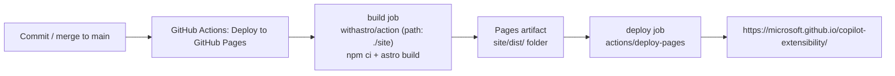

# Publishing the site to GitHub Pages

This guide explains, step by step, how the Copilot Extensibility Landing Site is built and published to
**GitHub Pages** from this repository, and how to keep it up to date.

- **Repository:** `microsoft/copilot-extensibility`
- **Default public URL:** <https://microsoft.github.io/copilot-extensibility/>
- **Framework:** [Astro](https://astro.build) (static site generation)
- **Source code:** the Astro project in the [`site/`](../site) folder
- **Deployment:** GitHub Actions workflow [`.github/workflows/deploy.yml`](../.github/workflows/deploy.yml)
- **Pages publishing source:** **GitHub Actions** (the site is deployed as an artifact — there is no `gh-pages` branch)

---

## How publishing works (overview)



1. Every push to `main` that changes `site/**` or the workflow (or a manual run) triggers the **Deploy to GitHub Pages** workflow.
2. The **build** job installs dependencies in `site/`, runs `astro build` and uploads the generated `site/dist/`
   folder as a GitHub Pages artifact.
3. The **deploy** job publishes that artifact to the `github-pages` environment.
4. The site is served as static HTML/CSS/JS by GitHub Pages — no server is involved.

---

## Prerequisites

| Requirement | Notes |
| --- | --- |
| Admin (or Maintain) permission on the repository | Needed to change **Settings → Pages** and environments. |
| GitHub Pages allowed for the organization | Org owners can restrict Pages under **Organization settings → Pages**. |
| GitHub Actions enabled for the repository | **Settings → Actions → General** → allow actions, including `withastro/action` and `actions/*`. |
| Node.js 22 (LTS) and npm — only for local testing | Matches the version used by the workflow (see [`.nvmrc`](../.nvmrc)). |

> **Note on allowed actions:** if the organization only allows a list of approved actions, make sure
> `actions/checkout`, `withastro/action` and `actions/deploy-pages` are allowed (the Astro action internally
> also uses `actions/setup-node` and `actions/upload-pages-artifact`).

---

## Step 1 — Verify the site configuration

Open [`site/astro.config.mjs`](../site/astro.config.mjs) and verify the two values that tell Astro where the site will live:

```js
const site = process.env.SITE_URL ?? 'https://microsoft.github.io';
const base = process.env.BASE_PATH ?? '/copilot-extensibility';
```

- `site` — the origin of the published site (`https://<owner>.github.io`).
- `base` — the sub-path, which for a GitHub Pages *project site* is `/<repository-name>`.

If the repository is forked or renamed, either update these defaults or set the `SITE_URL` / `BASE_PATH`
environment variables in the workflow (see [Custom domain](#optional--use-a-custom-domain)).

> All internal URLs in the JSON configuration files are written root-relative (e.g. `/copilot-logo.png`) and the
> components automatically prefix them with `base`, so **content files never need to change** when the
> base path changes.

## Step 2 — Build and preview locally (recommended)

```bash
cd site
npm ci            # install the exact dependency versions from package-lock.json
npm run check     # type-check components and validate the JSON files against their TypeScript contracts
npm run build     # generate the static site into ./dist
npm run preview   # serve ./dist at http://localhost:4321/copilot-extensibility/
```

Open the preview URL and check that styles, logo and links load correctly under the `/copilot-extensibility/`
sub-path. During development you can also use `npm run dev` for hot reload. See [DEVELOPING.md](./DEVELOPING.md)
for the complete local development guide.

## Step 3 — Commit the workflow file

The workflow is already part of the repository at [`.github/workflows/deploy.yml`](../.github/workflows/deploy.yml):

```yaml
on:
  push:
    branches: [main]
    paths:
      - 'site/**'
      - '.github/workflows/deploy.yml'
  workflow_dispatch:

permissions:
  contents: read
  pages: write
  id-token: write

jobs:
  build:
    runs-on: ubuntu-latest
    steps:
      - uses: actions/checkout@v7
      - uses: withastro/action@v6
        with:
          path: ./site
          node-version: 22
  deploy:
    needs: build
    runs-on: ubuntu-latest
    environment:
      name: github-pages
      url: ${{ steps.deployment.outputs.page_url }}
    steps:
      - id: deployment
        uses: actions/deploy-pages@v5
```

Key points:

- `permissions` grants the minimum rights to read the repository and create a Pages deployment
  (`id-token: write` is required by `deploy-pages` to verify the deployment's origin).
- `concurrency: pages` (in the full file) prevents two deployments from running at the same time.
- `withastro/action` builds the Astro project found in `path: ./site`: it detects the package manager from
  `site/package-lock.json`, runs the `build` script and uploads `site/dist/` as the Pages artifact.
- The `paths` filter redeploys only when something under `site/` (or the workflow itself) changes; edits to the
  README or to `docs/` don't trigger a deployment. Use **Run workflow** to force a deployment at any time.

## Step 4 — Enable GitHub Pages with "GitHub Actions" as the source

1. In the repository, open **Settings → Pages**.
2. Under **Build and deployment → Source**, select **GitHub Actions**.
   (Do **not** select "Deploy from a branch": this site is built by Actions, not served from a branch.)
3. (Optional, private/internal repositories on GitHub Enterprise Cloud) choose the Pages **visibility**.

Selecting **GitHub Actions** automatically creates the `github-pages` environment used by the workflow.

Alternatively, a repository admin can set the same option from the command line with the
[GitHub CLI](https://cli.github.com/):

```bash
# First time (Pages not enabled yet): create the Pages site with the GitHub Actions source
gh api -X POST repos/microsoft/copilot-extensibility/pages -f build_type=workflow

# Pages already enabled from a branch: switch the source to GitHub Actions
gh api -X PUT repos/microsoft/copilot-extensibility/pages -f build_type=workflow

# Verify: "build_type" must be "workflow"
gh api repos/microsoft/copilot-extensibility/pages --jq '{build_type, html_url}'
```

> If a `gh-pages` branch exists from earlier experiments, it is no longer used and can be deleted.

## Step 5 — (Optional) Protect the `github-pages` environment

1. Open **Settings → Environments → github-pages**.
2. Under **Deployment branches and tags**, keep **Selected branches and tags** with only `main` allowed
   (this is the default created by GitHub).
3. Optionally add **Required reviewers** if every publication must be approved by a maintainer.

## Step 6 — Trigger the first deployment

Choose one of the following:

- **Push/merge to `main`**: any commit on `main` starts the workflow automatically.
- **Manual run**: open **Actions → Deploy to GitHub Pages → Run workflow**, select `main` and confirm.

## Step 7 — Monitor the workflow

1. Open the **Actions** tab and select the running **Deploy to GitHub Pages** workflow.
2. Wait for both jobs to turn green:
   - **build** — installs, builds and uploads the artifact (typically ~1 minute).
   - **deploy** — publishes the artifact (typically a few seconds).
3. The **deploy** job summary (and **Settings → Pages**) shows the published URL.

## Step 8 — Verify the published site

Open <https://microsoft.github.io/copilot-extensibility/> and check:

- [ ] Page loads with styles and the logo (no 404s in the browser dev tools *Network* tab).
- [ ] Top menu anchors (Learn, Build, Technologies, Community) scroll to the right sections.
- [ ] The **Resources** dropdown, the search box and the light/dark toggle work.
- [ ] External links open in a new tab.
- [ ] The layout works on a mobile-size viewport.

> GitHub Pages is served through a CDN; changes can take a minute or two to appear. Use a hard refresh
> (<kbd>Ctrl</kbd>/<kbd>Cmd</kbd> + <kbd>Shift</kbd> + <kbd>R</kbd>) if you still see the previous version.

---

## Day-to-day: updating the content

Content lives in JSON files under [`site/src/data/`](../site/src/data) (one file per landing-page block — see
[ARCHITECTURE.md](./ARCHITECTURE.md)). The recommended flow is:

1. Create a branch and edit the relevant JSON file (e.g. add an event to `community-events.json`).
2. Run `npm run check` and `npm run build` locally (or rely on the reviewer's preview).
3. Open a pull request; once approved, **merge to `main`**.
4. The workflow publishes the new version automatically.

> Event lists are evaluated at **build time**. If `hidePast` is enabled for an event group, past events disappear
> on the next deployment. To refresh regularly without content changes, you can add a `schedule` trigger to the
> workflow, for example a daily rebuild:
>
> ```yaml
> on:
>   schedule:
>     - cron: '0 5 * * *'
> ```

## Rolling back

Every deployment is tied to a workflow run. To roll back:

- **Preferred:** revert the offending commit on `main` (`git revert <sha>`) and push — a new deployment runs.
- **Quick:** open a previous successful run in **Actions** and select **Re-run all jobs** — it rebuilds and
  redeploys that commit.

---

## (Optional) Use a custom domain

1. Configure DNS with your domain provider (a `CNAME` record pointing to `microsoft.github.io` for a subdomain).
   See [Managing a custom domain for your GitHub Pages site](https://docs.github.com/pages/configuring-a-custom-domain-for-your-github-pages-site/managing-a-custom-domain-for-your-github-pages-site).
2. Add a file `site/public/CNAME` containing only the domain name, e.g. `copilot-extensibility.example.com`.
3. Make Astro build for the root of the domain by setting the environment variables in the workflow:

   ```yaml
   - uses: withastro/action@v6
     with:
       path: ./site
       node-version: 22
     env:
       SITE_URL: 'https://copilot-extensibility.example.com'
       BASE_PATH: '/'
   ```

4. In **Settings → Pages → Custom domain**, enter the domain, save, and enable **Enforce HTTPS** once the
   certificate has been issued.

---

## Troubleshooting

| Symptom | Likely cause | Fix |
| --- | --- | --- |
| Page loads without styles / logo, 404 on `/assets/...` | `base` does not match the repository name or the custom-domain setup. | Fix `base` / `BASE_PATH` (Step 1 or custom domain step 3). |
| `Get Pages site failed` or `Not Found` in the deploy job | Pages is not enabled or source isn't **GitHub Actions**. | Complete Step 4. |
| `Branch "x" is not allowed to deploy to github-pages due to environment protection rules` | Deploying from a branch other than the allowed ones. | Deploy from `main`, or add the branch in **Settings → Environments → github-pages**. |
| `Resource not accessible by integration` / permission errors | Missing `pages: write` / `id-token: write`, or org restricts workflow permissions. | Keep the `permissions` block of the workflow; ask an org owner to allow it. |
| `The action ... is not allowed` | Organization allows only approved actions. | Allow the actions listed in [Prerequisites](#prerequisites). |
| Build fails in `astro check`/`build` with a type error on a JSON file | A JSON file doesn't match its contract in `site/src/types/config.ts`. | Fix the JSON (missing/mistyped property) — the error message points at the field. |
| Site shows old content | CDN/browser cache. | Wait a couple of minutes and hard-refresh. |

## References

- [Astro — Deploy your Astro site to GitHub Pages](https://docs.astro.build/en/guides/deploy/github/)
- [`withastro/action`](https://github.com/withastro/action)
- [GitHub Docs — Using custom workflows with GitHub Pages](https://docs.github.com/pages/getting-started-with-github-pages/using-custom-workflows-with-github-pages)
- [GitHub Docs — Configuring a publishing source](https://docs.github.com/pages/getting-started-with-github-pages/configuring-a-publishing-source-for-your-github-pages-site)
